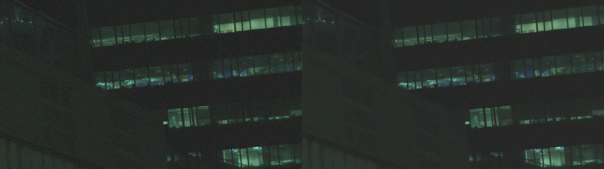

# AI_RAW_NR

独立完成 AI RAW 降噪模型的研究与实现。模型规模为 **1,086,036 个参数（1.0860 M）**，处理一张 **256×256 Bayer 图像约需 0.2024 G MACs**。图像处理流程包含黑电平校正、自动白平衡、自动曝光、去马赛克和模型降噪。

### SIDD-CC 评测结果

| 方法 | 训练/评测类型 | PSNR ↑ (dB) | SSIM ↑ |
|---|---|---:|---:|
| 本模型 | 自监督（本地评测） | **50.2022** | **0.99334** |
| YOND | 盲降噪（论文基线） | 50.15 | 0.991 |
| B2U | 自监督 | 49.41 | 0.988 |
| NAFNet | 有监督 | 51.63 | 0.995 |

本模型的 SIDD-CC 结果高于该论文列出的盲降噪 / 自监督基线，其中 YOND 是该组最高结果；有监督 NAFNet 分数更高，因此本结果不代表 SIDD-CC 全方法最高。公平比较以评测划分、输入处理和指标计算口径一致为前提。

数据来源：Mohammadi et al., [*Why Low-Light Cameras Go Color Blind: Removing Color Bias in Raw Denoising*](https://arxiv.org/abs/2607.11090), arXiv:2607.11090v1, Table 3(b)（SIDD-CC RAW 验证集）。本模型结果为本地评测。

> 拍摄照度约为 **1–0.1 lux**。以下均为左右对比图：左侧为处理前，右侧为模型降噪后；为便于观察细节，保留原始全分辨率。

## 效果对比

### 自动采集图像

#### cam0_still_000007_in

#### IMG_0012

#### IMG_0018

#### IMG_0019

### 实拍图像

#### grren55_long_f0

#### low_low_long_f0

