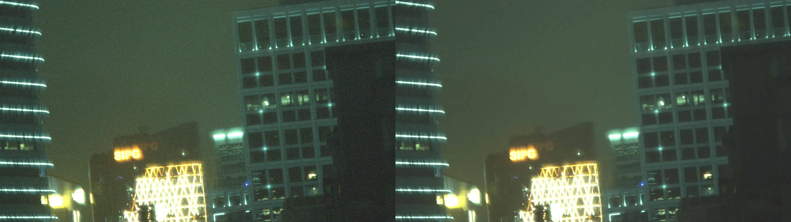
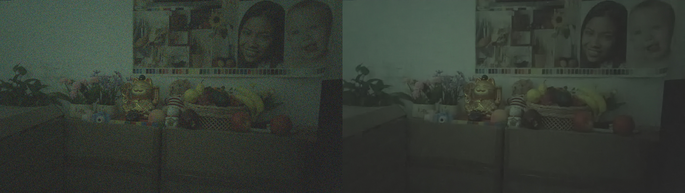

# AI_RAW_NR

独立完成 AI RAW 降噪模型的研究与实现。模型规模为 **1.08M 参数**，处理一张 **1080p 图像约需 9.322 GMACs**。图像处理流程包含黑电平校正、自动白平衡、自动曝光、去马赛克和模型降噪。

### SIDD-CC 评测结果

在 SIDD-CC 上，模型取得 **50.2022 dB PSNR / 0.99334 SSIM**。与论文 *Why Low-Light Cameras Go Color Blind: Removing Color Bias in Raw Denoising*（arXiv:2607.11090v1，Table 3）报告的 SIDD-CC RAW 盲降噪基线 YOND（**50.15 dB / 0.991**）相比，PSNR 高 **0.0522 dB**，SSIM 高 **0.00234**，超过该论文列出的盲降噪结果。**这不是 SIDD-CC 全部方法的最高分**：同表中有监督 NAFNet 为 51.63 dB / 0.995 SSIM。该比较以评测划分、输入处理和指标计算口径一致为前提。

> 拍摄照度约为 **1–0.1 lux**。以下均为左右对比图：左侧为处理前，右侧为模型降噪后；为便于观察细节，保留原始全分辨率。

## 效果对比

### 自动采集图像

#### cam0_still_000007_in

#### IMG_0012

#### IMG_0018

#### IMG_0019

### 实拍图像

#### grren55_long_f0

#### low_low_long_f0

