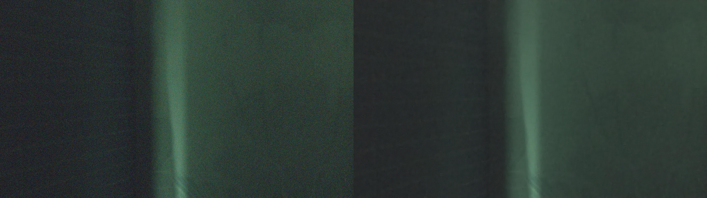
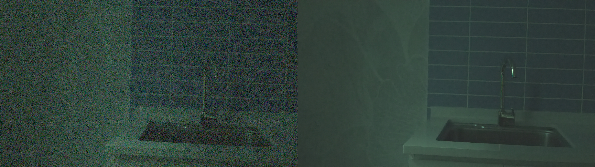
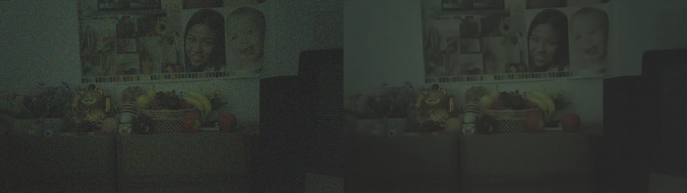

# AI_RAW_NR

独立完成 AI RAW 降噪模型的研究与实现。模型规模为 **1.08M 参数**，处理一张 **1080p 图像约需 9.322 GMACs**。以下展示模型在低照度实拍图像上的降噪效果；图像处理流程包含黑电平校正、自动白平衡、自动曝光、去马赛克和模型降噪。

> 拍摄照度约为 **1–0.1 lux**。以下均为左右对比图：左侧为处理前，右侧为模型降噪后；为便于观察细节，保留原始全分辨率。

## 效果对比

### 自动采集图像

#### cam0_still_000007_in

#### IMG_0012

#### IMG_0018

#### IMG_0019

### 实拍图像

#### grren55_long_f0

#### low_low_long_f0

